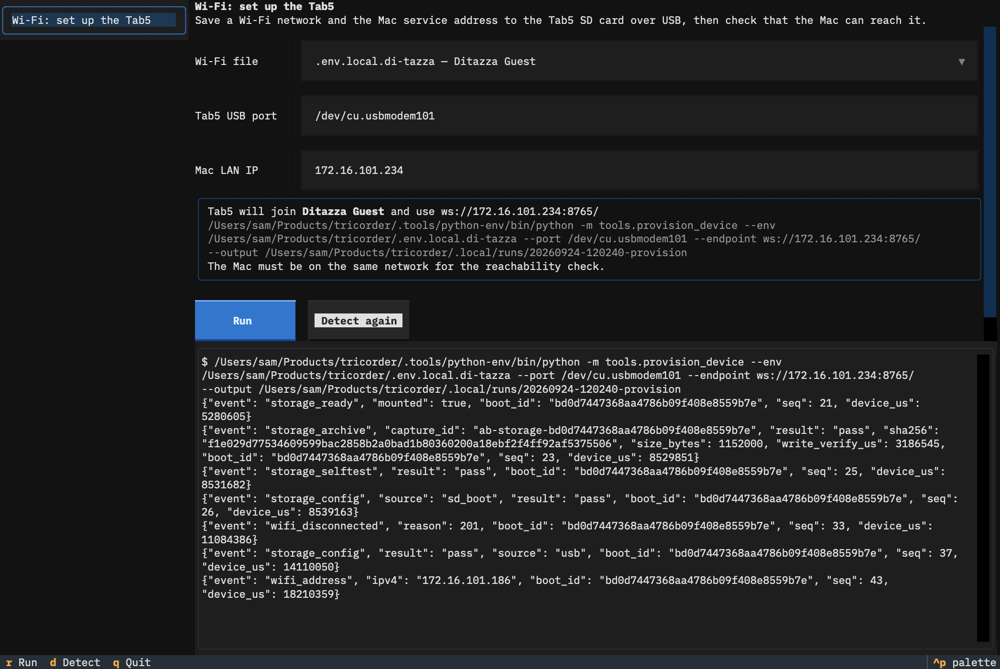

# Tricorder

A handheld with a screen, touch and sensors (M5Stack Tab5, ESP32-P4), talking to an LLM that runs locally on a Mac.

The device shows live sensor readings. The person opens an instrument, measures, taps Analysis and then Explain. The Mac, joined to the device's own Wi-Fi hotspot, has a local model (Ollama) read the analysis and speaks the answer back (Pocket TTS). No router, no Internet. Sound, Motion, Camera and Power work this way today. Co-developed with OpenAI Codex and Claude Code.

## Start here

- [Vision](vision.md): the product concept.
- [Milestones](planning/milestones.md): current state and next work, via Milestone → Feature → Trials, plus [ADRs](planning/adrs/).
- [Planning guidelines](planning/README.md): how the docs are kept.
- [Service wire protocol](planning/guided-ab-protocol.md) and [operations](planning/guided-ab-operations.md) (provisioning, replay). Written for the dropped guided A/B; the transport and provisioning parts still apply.
- [GitHub issues](https://github.com/AlteredCraft/tricorder/issues): the work queue. The milestone's **Active** line says which is next.
- [TODO](TODO.md): tasks that need the operator.

## Layout

| Path | Contents |
| --- | --- |
| `firmware/` | ESP-IDF 5.4.2 app (`main/`): start screen (`home*`), Sound, Motion and Power instruments with header-only analyses (`sound*`, `motion*`, `power*`), Camera (`camera*`), Setup screen, service client (`investigation.cpp`, slated for trimming in #6), SD, Wi-Fi, diagnostics |
| `tools/` | Mac-side Python: the service (`investigation_service.py`, with `sound_explain.py`, `motion_explain.py`, `camera_explain.py` and `power_explain.py` per instrument), serial collector, provisioning, evidence assessors |
| `tests/` | Host tests (Python + native C++ under ASan) |
| `planning/` | Milestones, features, ADRs, fixtures; M-0001 goals/specs as history |
| `.tools/`, `.local/` | Ignored: toolchains, private runs, captures, backups |

## Development

Requires Git, `uv` and Python 3.

```sh
python3 tools/bootstrap.py                     # pinned vendor sources + ESP32-P4 toolchain
tools/idf.sh -C firmware build
tools/idf.sh -C firmware -p PORT flash         # confirm the board's USB identity first
python3 -m venv .tools/investigation-env
.tools/investigation-env/bin/python -m pip install -r tools/investigation-requirements.txt -r tools/openai-requirements.txt
.tools/investigation-env/bin/python -m pip install -r tools/stt-requirements.txt   # local speech-to-text (Apple Silicon)
.tools/investigation-env/bin/python -m pip install -r tools/tts-requirements.txt   # local spoken guidance (Pocket TTS)
.tools/investigation-env/bin/python -m unittest discover -s tests -q
```

Bench operations TUI (needs only `uv`; tasks are in `tools/ops_tasks.py`). It currently sets up the Tab5's Wi-Fi and Mac service address and checks the Mac can reach it:

```sh
uv run tools/ops.py
```



Serial capture of a diagnostic run (see `--help` for `--checks`, `--stop-file`, `--spec-id`):

```sh
.tools/python-env/bin/python -m tools.capture_serial --port PORT --output .local/runs/NEW --seconds 360 --reset
```

Evidence assessors (`python3 -m tools.<name> RUN_DIR`): `camera_baseline_evidence`, `audio_baseline_evidence`, `imu_baseline_evidence`, `ui_baseline_evidence`, `jpeg_evidence`, `preview_evidence`, `restart_evidence`, `device_spectrum`, `investigation_evidence`. `tools.inspect_capture` converts a capture to PNG/WAV.

## Device notes

- The Tab5's USB serial is **E8:F6:0A:E2:E0:0E**. Rediscover the port with `.tools/python-env/bin/python -m serial.tools.list_ports -v`; another attached board may show up too.
- **Opening the serial port can reset the Tab5.** Keep one collector open for a whole trial, and prefix long runs with `/usr/bin/caffeinate -is` (Mac sleep drops USB data).
- Wi-Fi and the service endpoint load from SD at boot. Provision them with `tools.provision_device` or the ops TUI ([operations doc](planning/guided-ab-operations.md#sd-provisioning-archive-and-download)). The SD card holds plaintext Wi-Fi credentials, so keep it private. Currently provisioned (2026-11-03) in hotspot mode (`.env.local.tricorder-ap`, network "Tricorder", device at 192.168.4.1; run `20261103-provision-ap`). Before that: the phone hotspot (`.env.local.hotspot`, endpoint 172.20.10.9:8765; the device got 172.20.10.10).
- **Hotspot mode** (F-0003): an env file with `WIFI_MODE=ap` (`.env.local.tricorder-ap`, network "Tricorder") makes the device broadcast its own network at 192.168.4.1. Join the Mac to it and start the service with the default `--host 0.0.0.0`; the device sets the service address from the Mac's DHCP lease (`wifi_ap_client` event) and the Setup tile shows "Hotspot on / Mac 192.168.4.x". The Mac has no Internet while joined unless it has another connection, so the service runs with `--provider local` (the default setup). Before `a09a2b2`, live sessions lost Wi-Fi when internal RAM ran out during uploads ([G-0001.02](planning/plans/G-0001.02-concurrent-workload.md#observed)). nossa-7c-guest (`.env.local.nossa-7c-guest`) passes device-to-Mac traffic, ping 93–187 ms.
- Headphones in the Tab5 jack turn the speaker amp off (since `0fede86`); unplugging turns it back on.
- The private `firmware/sdkconfig` sets `CONFIG_TRICORDER_GUIDED_AB_STARTUP=y`: boot to the start screen with the radio up, skipping the automatic media diagnostics.
- Flash backups and recovery steps: `.local/runs/20260920-baseline/RECOVERY.md`.
- Secrets live in ignored `.env.local.*` files. Never print or commit them.
- Guest/café Wi-Fi usually blocks client-to-client traffic (the device can't reach the Mac). Use a phone hotspot on 2.4 GHz (iPhone: Maximize Compatibility) for both, and copy the SSID exactly (iPhone names use a curly ’).

## Mac service

Everything runs locally. With [Ollama](https://ollama.com) running on the Mac (default model `gemma4:latest` at `http://127.0.0.1:11434/v1`; `--model` and `--base-url` change them):

```sh
.tools/investigation-env/bin/python -m tools.investigation_service --output .local/runs/NEW --provider local
```

The service listens on `ws://0.0.0.0:8765` and speaks replies with Pocket TTS, voice "alba" (`--tts pocket`, the default; `--tts say` uses macOS speech, `--tts none` turns it off). Local speech-to-text (Parakeet, `--stt parakeet`) still loads for a later voice demo; `--stt none` skips it.

Only the device's analysis numbers go to the model, with a `kind` field (sound, motion) that picks the prompt and the checker. The model writes the explanation; the service rejects replies that quote numbers the analysis doesn't contain.

A hosted model is still possible for comparison: put `OPENROUTER_API_KEY` in the ignored `.env.local.openrouter` and run with `--provider openrouter --model openai/gpt-5.6-sol --env .env.local.openrouter`. The Mac then needs Internet, so this doesn't work while joined to the device's hotspot.

## License

[MIT](LICENSE)
